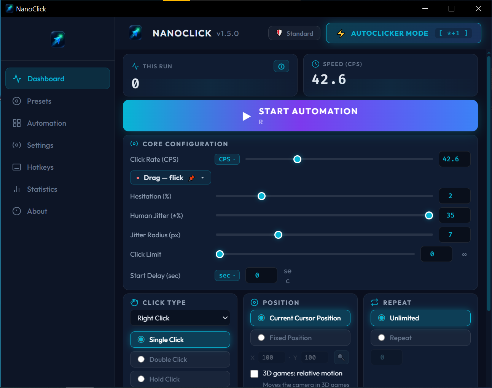

# NanoClick

**A native Windows auto clicker and visual macro editor that respects your machine.**
Fast, unkillable, and built with pure Rust. No Electron, no adware, no background bloat.

<p align="center">
  
  
  
  
  <a href="https://github.com/Ar3ss12/nanoclick/actions/workflows/ci.yml"></a>
</p>

> **The honest reason this exists:**
> Almost every auto clicker on the first page of Google is either an ad-ridden
> executable from 2008 that triggers your antivirus, or a 200 MB Electron
> monster that stutters your game. NanoClick is what desktop utilities used to
> be: a single clean ~9 MB binary that idles at 5 MB RAM, feels like a human
> hand, and never locks your mouse buttons down if a game crashes.

<p align="center">
  <a href="https://github.com/Ar3ss12/nanoclick/releases/latest">
    <b>[ Download Installer — 3.5 MB ]</b>
  </a>
  &nbsp;&nbsp;•&nbsp;&nbsp;
  <a href="https://github.com/Ar3ss12/nanoclick/releases/latest">
    <b>[ Download Portable — 9.8 MB ]</b>
  </a>
</p>

<p align="center">
  
</p>

---

## 10-Second Quick Start

1. Grab the **[installer](https://github.com/Ar3ss12/nanoclick/releases/latest)** or run the portable `.exe` directly.
2. Press <kbd>F6</kbd> (or <kbd>R</kbd>) to start clicking.
3. Hit <kbd>Escape</kbd> anytime for an immediate emergency stop.

---

## The Reality Check

| The usual download from the web | NanoClick |
|---|---|
| 150+ MB RAM, built on a web browser, closed-source `.exe` of unknown origin | **5.3 MB RAM in tray**, 9.8 MB standalone binary, open source |
| If the game crashes, your mouse stays stuck in a frantic click loop | **An independent watchdog outside the app** unlocks your buttons instantly |
| Robotic, metronome-flat intervals, flat as a machine | **Human hand biomechanics** (natural jitter and fatigue curve) calculated in nanoseconds |

---

## What It Actually Does

### Precision Click Engine
* **All the modes you need:** Single, Double, Hold, Butterfly, and Drag from 0.1 to 160 CPS.
* **Human, not robotic:** Timing mimics real finger muscles with subtle micro-jitter and spatial variance.
* **Zero game stutter:** Click timing math runs on a dedicated worker thread and costs nanoseconds. Your FPS will never dip.
* **Click where you want:** Lock clicks to specific screen coordinates or let it follow your cursor. Toggle between CPS and millisecond intervals on the fly.
* **One owner at a time:** a click run and a macro playback can never inject into the same cursor together — the second one is refused at start with a named reason instead of interleaving.

### Visual Macro Editor
* **Record or build:** Hit record to capture a mouse sequence in real time, or assemble actions block-by-block in the editor.
* **No messy swipe spam:** Raw mouse drag recordings are automatically compressed by 80–95 %. Jittery hand swipes turn into clean, smooth paths.
* **Real logic:** Build sequences with `Repeat`, `If/Else` branches based on pixel colors, variables, and nested macro calls.
* **Hotkey presets:** Switch between full profiles instantly mid-game.

### Engineered Not to Annoy You
* **Mouse never gets trapped:** If NanoClick crashes, freezes, or is force-killed via Task Manager, an independent companion process catches it and releases your physical mouse buttons.
* **Smart Typing Guard:** Pauses clicking automatically the second you start typing in a chat box, so you don't ruin your messages.
* **FocusGuard:** Pauses within 50 ms if you Alt+Tab out of your game.
* **Lock screen and UAC aware:** when Windows switches to a secure desktop (lock, UAC prompt, Ctrl+Alt+Del), NanoClick releases every held button and stops the run instead of clicking into a desktop that swallows input.
* **True background daemon:** The clicking engine runs independently of the window. You can close the interface, minimize to tray, and it idles at just **5.3 MB of RAM**.

---

## Default Hotkeys

| Action | Hotkey |
|---|---|
| **Start / Stop** | <kbd>F6</kbd> / <kbd>R</kbd> / <kbd>K</kbd> |
| **Emergency Stop** | <kbd>Escape</kbd> |
| **Speed Adjust (±1 CPS)** | <kbd>Ctrl</kbd> + <kbd>=</kbd> / <kbd>Ctrl</kbd> + <kbd>−</kbd> |
| **Pick Screen Position** | <kbd>Ctrl</kbd> + <kbd>P</kbd> |
| **Record Macro** | <kbd>Ctrl</kbd> + <kbd>Shift</kbd> + <kbd>R</kbd> |
| **Toggle Work Mode** | <kbd>Ctrl</kbd> + <kbd>Alt</kbd> + <kbd>M</kbd> |

---

<details>
<summary><b>Building from Source & Technical Details</b></summary>

### System Requirements
* Windows 10 or 11 (64-bit)
* WebView2 runtime (pre-installed on modern Windows; downloaded automatically if missing)

### Compilation
```bash
git clone https://github.com/Ar3ss12/nanoclick.git
cd nanoclick
cargo tauri dev                    # Run locally
cargo tauri build --bundles nsis   # Build setup installer
```
*Requires Rust (stable-msvc) and Microsoft C++ Build Tools.*
Full architecture details and test harnesses live in [CONTRIBUTING.md](CONTRIBUTING.md).
What's new: [CHANGELOG.md](CHANGELOG.md)

</details>

---

## License

Free for personal and non-commercial use under the **PolyForm Noncommercial License 1.0.0** ([LICENSE.md](LICENSE.md)).
*Commercial operations and redistributing binaries for profit require a commercial license.*

<p align="center">
  <sub>© 2026 Ar3ss12 · Native Rust on Windows</sub>
</p>
